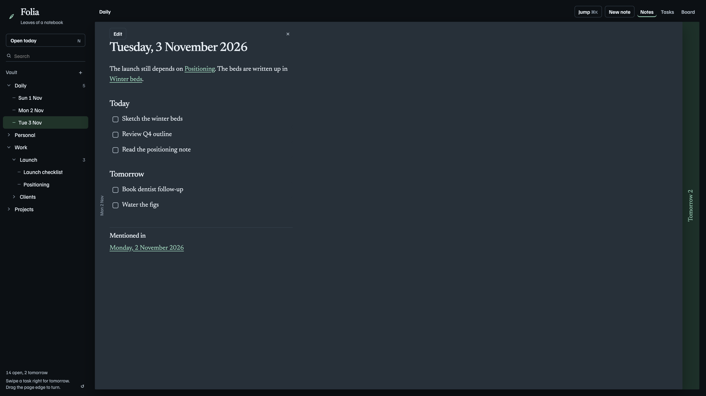
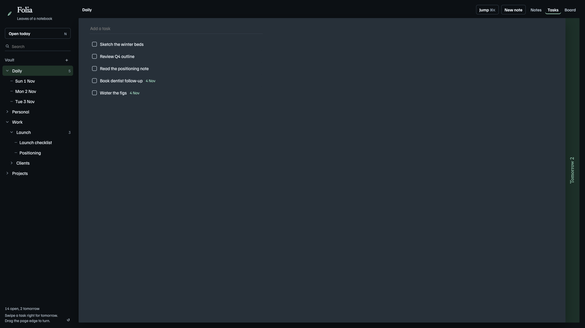
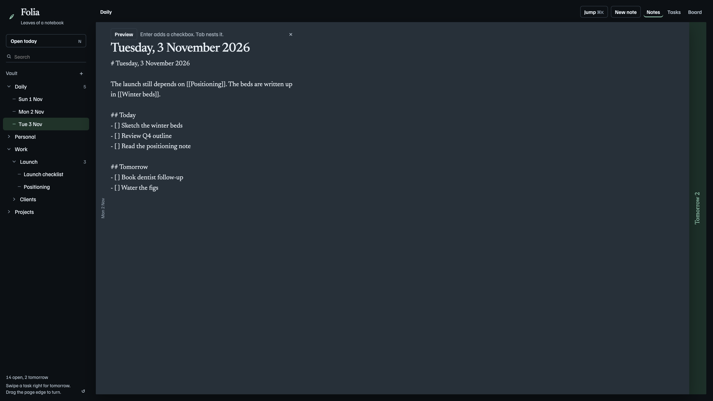

# Folia

Folia is a notebook that stays in the browser. Folders, notes, tasks, and a board share one vault. Work you leave unfinished is carried onto the next day.



## Run

```bash
./run.sh
```

That builds the page into a small nginx container and serves it at [http://localhost:8080](http://localhost:8080). Docker needs to be running. Stop it with `docker rm -f folia`.

The app is a single `index.html`. Everything you write is stored in `localStorage` in that browser.

## Notes

The tree on the left is the vault. `[[Note title]]` is a link. Hover a link for a short preview of where that note sits and what it says, then click through. Pages that mention the open note are listed under Mentioned in.

Turn the page by dragging its edge, pressing `[` or `]`, or swiping horizontally on a trackpad. Jump to any note with ⌘K (Ctrl+K on other keyboards).

## Tasks

Each daily note has a Today section and a Tomorrow section. The green edge on the right is the next day: open it to see what is waiting, or add a task there.



- Swipe a task right to schedule it for the day on that edge. Swipe left to complete it.
- **Open today** (or press N) copies unfinished tasks from the latest daily note onto today. Right-click a folder and mark it as the daily folder first.

## Editing

Press Edit on a note.



- Enter adds a checkbox at the same indent. On a blank line, it turns that line into a checkbox. On a task, it opens the next one.
- Tab nests the current line as a subtopic. Shift+Tab, or Backspace at the start of the checkbox, brings it back out.
- Enter on an empty checkbox leaves the list.

Open folder reads a directory of markdown files. A note named `YYYY-MM-DD.md` is a daily note. Edits write back to those files in Chrome and Edge.
