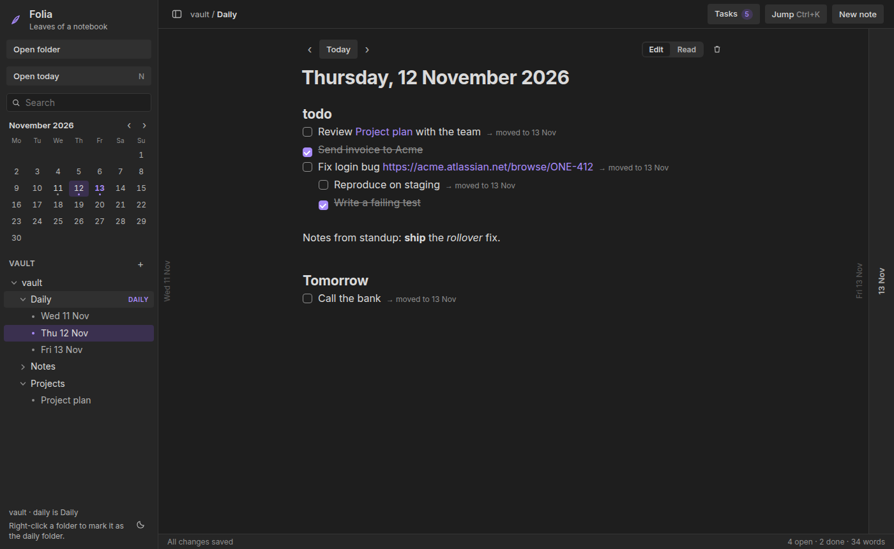
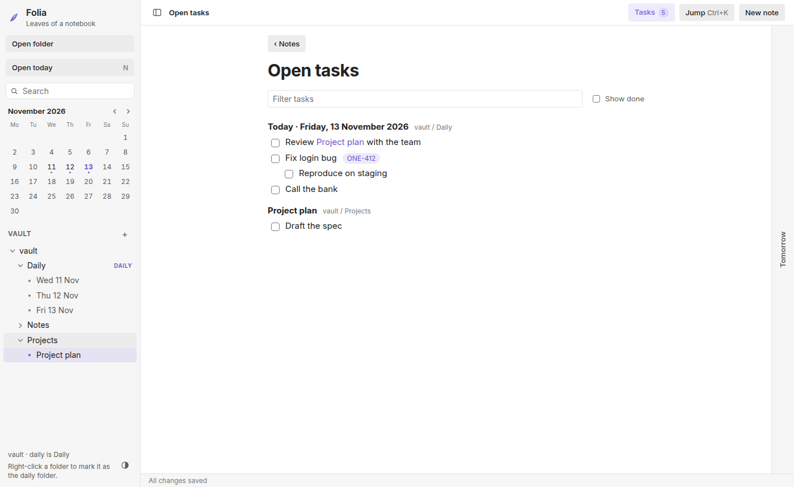

# Folia

Folia is a notebook in the browser for a folder of markdown files. You write in a live preview editor, and a daily note carries your unfinished tasks onto the next day.



## Run

```bash
./run.sh
```

That builds the page into a small nginx container and serves it at [http://localhost:8080](http://localhost:8080). Docker needs to be running. Stop it with `docker rm -f folia`.

Press **Open folder** and pick a folder of `.md` files. In Chrome and Edge, every edit is written straight back to those files. Other browsers open a read-only copy, and the status bar says so.

## Writing

Notes open in the editor with live preview: headings, bold, links and checkboxes look as they will read, and the markdown shows again on the line your cursor is on. **Read** (or ⌘E / Ctrl+E) switches to the reading view.


- Tab on an empty line makes a task, so a heading, Enter, Tab gives you a checkbox under it. Typing `- [ ] ` works too. Click a box to tick it, or press ⌘Enter / Ctrl+Enter on the line.
- Enter on a list item or task starts the next one. Enter on an empty one ends the list. On a line with text, Tab and Shift+Tab nest and un-nest.
- `#word` is a tag. Type `!!` and a space after a task to tag it `#important`: it gets a red tag and a red edge. `#` suggests tags already in the vault, `important` first.
- Under the title, a note shows when it was last edited, and when it was created if Folia knows: from a `created:` line in the front matter, or because Folia made the file.
- `[[` suggests note titles. Click a `[[link]]` to open that note; one to a note that does not exist yet creates it.
- Rename a note by editing its title. The file is renamed, and `[[links]]` to it in other notes are updated.
- ⌘F / Ctrl+F searches the note. The status bar shows open and done tasks, the word count and whether everything is saved.

## Daily notes and rollover

Choose a folder for daily notes. A banner offers the folder that already holds most dated notes, or creates a Daily folder. You can also right-click any folder. Daily notes are named `YYYY-MM-DD.md`.


- Unfinished tasks from the latest earlier daily note, and anything under its `## Tomorrow` heading, are copied into today's `## todo`. Nesting is kept. A done parent stays behind and its open subtasks move up a level.
- Earlier notes are never changed.
- Rollover runs by itself once a day: when the folder opens, and when the date changes while the app is open. **Open today** (or N) runs it any time. Nothing already on today is copied again.
- The calendar in the sidebar opens any day. A dot marks a day with a note, and a coloured dot means it still has open tasks. ‹ Today › above a daily note steps between days.
- The Tomorrow edge on the right lists what is set for the next day and takes new tasks for it. In the reading view, swipe a task right to move it there, or left to complete it.

## All tasks

**Tasks** in the top bar lists the open tasks in every note. A task carried over several days is listed once, from its newest note. Each one says which day it first appeared, such as "since 12 Nov". Tick tasks there, filter them, show only `#important` ones, or show the done ones too.



## More

- ⌘K / Ctrl+K jumps to any note or action. `[` and `]` turn the page.
- The button at the bottom of the sidebar switches between system, light and dark themes. The sidebar button in the top bar (or ⌘\ / Ctrl+\) hides the sidebar. On a phone the sidebar opens as a drawer.

## Tests

The browser tests run against an in-memory folder.

```bash
npm i playwright
node tests/rollover.test.js   # rollover
node tests/live.test.js       # editor, tags, task list, calendar, rename, banner, theme
```

Set `CHROME=/path/to/chrome` if Playwright's own browser is not installed. `tests/run-nuc.sh` copies the app to a build box and runs them there.

## Editor bundle

The editor is CodeMirror 6, bundled into `vendor/editor.js` so the app works offline. To rebuild it, run `cd vendor-src && npm install && npm run build`.
